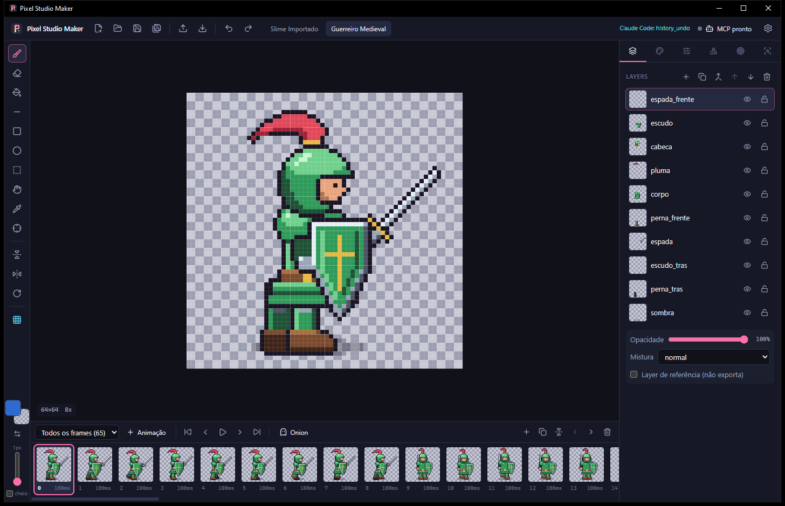
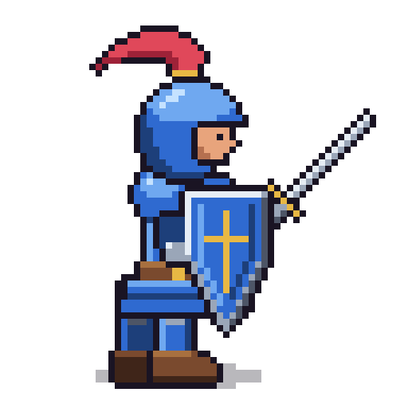
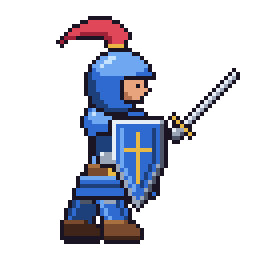
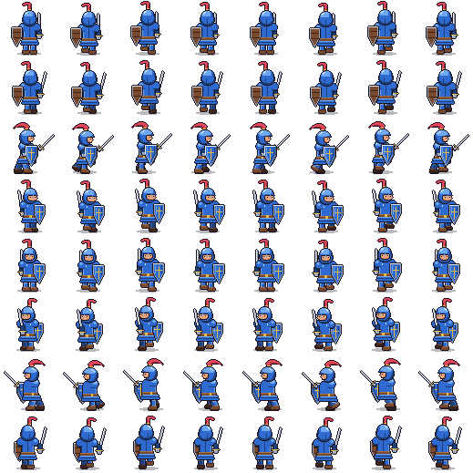

<p align="center"></p>

<h1 align="center">Pixel Studio Maker</h1>

<p align="center"><strong>Pixel art e sprite sheets, à mão ou pelo Claude.</strong><br />Um editor open source de pixel art e animação em que agentes de IA desenham pixel por pixel, pelo MCP.</p>

<p align="center">
  <a href="LICENSE"></a>
  
  
</p>

<p align="center"></p>

O Pixel Studio Maker é um editor de pixel art para criar, editar e animar sprites, com um servidor
**MCP nativo em Rust**. O editor visual e o MCP são duas portas para o mesmo motor: o que o Claude
desenha aparece no editor na hora, e o que você pinta no editor o Claude lê.

Nada aqui gera imagem com IA. O agente decide; o motor executa cada pixel, de forma determinística.

## Feito pelo MCP

Tudo abaixo foi desenhado pelo Claude usando só as ferramentas MCP do editor
(roteiros em [examples/](examples)).

| | |
|---|---|
|  |  |
| Guerreiro 64x64 do zero, com 8 layers, paleta de 18 cores, regiões e anchors | Caminhada de 8 frames com poses de verdade |
|  |  |
| As 8 direções, exportadas para o Godot | Um PNG de fora, importado e animado (idle de 6 frames) |

## Recursos

- **Editor**: lápis pixel-perfect, borracha, balde, linha, retângulo, elipse, seleção, mover, conta-gotas,
  espelhar e girar; zoom sem suavização, grade, fundo xadrez, onion skin, referências; layers com
  opacidade, modos de mistura, bloqueio e layers de referência; paletas; linha do tempo com animações,
  direções, durações, repetição (loop, uma vez, ping-pong, reverso) e reprodução; regiões semânticas,
  anchors, pivô; inspeção e validação; undo/redo e snapshots.
- **Converter imagem em pixel art**: PNG, JPG ou GIF de qualquer tamanho viram pixel art estática, com
  tamanho de saída configurável, remoção de fundo, recorte automático ou manual, paleta calculada ou fixa,
  dithering, limpeza e contorno. Prévia ao vivo no editor; o mesmo comando (`image_pixelate`) no MCP.
- **MCP**: 85 ferramentas com schema tipado, imagens de inspeção devolvidas como conteúdo do MCP,
  recursos (guia do agente, estado do projeto, prévias) e prompts com fluxos de trabalho.
- **Desenho em lote (SDC)**: dezenas de operações numa chamada, atômicas; matrizes de texto com legenda,
  RLE, patches de diferença, polígonos, curvas, contornos, dithering, degradês, sombreamento por direção
  da luz, padrões, transformações.
- **Animação**: frames com duração própria, cels vinculadas, trilhas por direção (8 padrão + vistas
  personalizadas), poses e ciclos registrados, comparação entre frames.
- **Runtime compartilhado**: um processo local guarda o estado oficial; editor e MCP conectam por Named
  Pipe, com revisões, transações, eventos em tempo real, recuperação automática e funcionamento sem
  janela.
- **Formatos**: projeto `.psmproj` versionado (ZIP com manifesto JSON e PNGs, gravação atômica);
  importa PNG, JPG (para conversão), GIF e sprite sheets; exporta PNG, sequência de PNGs, GIF, sprite sheet (5 layouts, com
  alinhamento por pivô) com JSON e `SpriteFrames` do Godot 4.

## Usar com o Claude Code

1. Instale o editor (ou compile, veja abaixo).
2. No editor, clique em **MCP** no canto superior direito e copie o comando, ou rode:

   ```sh
   claude mcp add pixel-studio-maker -- "%LOCALAPPDATA%\Pixel Studio Maker\psm.exe" mcp
   ```

3. Peça ao Claude Code, por exemplo: *"Crie um personagem de pixel art 64x64, um guerreiro medieval, com
   as animações idle e walk em oito direções, e exporte para Godot."*

O editor não precisa estar aberto: o Claude inicia o runtime sozinho. Se estiver aberto, você acompanha
cada traço. Mais detalhes em [examples/claude-code](examples/claude-code).

## Documentação

- [Guia do agente](docs/guia-do-agente.md): como planejar, desenhar, animar e corrigir (também servido pelo MCP)
- [Ferramentas MCP](docs/ferramentas-mcp.md) e [linguagem SDC](docs/sdc.md)
- [Arquitetura](docs/arquitetura.md): crates, runtime, protocolo, contratos
- [Formato .psmproj](docs/formato-psmproj.md) e [exportação](docs/exportacao.md)
- [Demonstrações](examples)

## Desenvolvimento

Requisitos: [Rust](https://rustup.rs) estável, [Node.js](https://nodejs.org) 24 e [pnpm](https://pnpm.io),
Windows 10/11 com WebView2.

```sh
pnpm install
pnpm dev                      # abre o editor em modo de desenvolvimento (compila o psm antes)
pnpm build                    # instalador NSIS em target/release/bundle/nsis

cargo test --workspace        # 105 testes: motor, comandos, runtime, MCP por stdio, regressão por imagem
cargo clippy --workspace --all-targets -- -D warnings
cargo run -p sprite-cli -- --help
```

O editor de desenvolvimento usa a porta 1430.

```
crates/
  sprite-core/        cores, imagens, paletas, máscaras, composição, diferenças, PNG
  sprite-drawing/     algoritmos de desenho e a linguagem SDC
  sprite-animation/   modelo do sprite, composição, sprite sheets, validação
  sprite-project/     documento com histórico, formato .psmproj, importação, exportação
  sprite-commands/    a camada única de comandos (editor e MCP)
  sprite-runtime/     o processo com o estado oficial + protocolo IPC
  sprite-mcp/         o servidor MCP
apps/desktop/         o editor (Tauri 2 + React + TypeScript + Tailwind)
tools/sprite-cli/     o executável psm (MCP, runtime, linha de comando)
tests/                regressão: reexecuta as demonstrações e compara pixel a pixel
examples/             as demonstrações A a E
docs/                 documentação
```

## Licença

[MIT](LICENSE). © 2026 CodePlay77.
