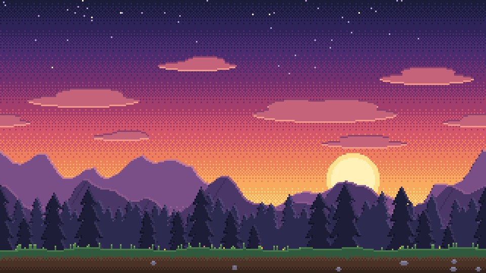
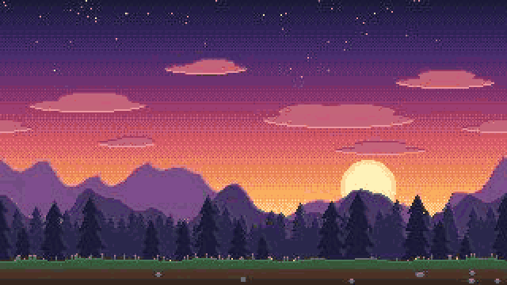

# Cenário em parallax

Fundo de entardecer 320×180 em 7 camadas, desenhado só com operações do MCP (`gerar.mjs`). Cada camada
se emenda na horizontal: a borda direita continua na esquerda, então ela pode rolar sem fim.





## Camadas

| Arquivo | Velocidade | O que é |
|---|---|---|
| `01_ceu.png` | 0 (parada) | degradê do entardecer, estrelas e o sol |
| `02_nuvens.png` | 0,1 | nuvens iluminadas por baixo |
| `03_montanhas_longe.png` | 0,2 | montanhas distantes, com névoa no pé |
| `04_montanhas_perto.png` | 0,35 | montanhas mais próximas, com vincos |
| `05_floresta_longe.png` | 0,55 | pinheiros distantes |
| `06_floresta_perto.png` | 0,75 | pinheiros próximos, com clareiras |
| `07_chao.png` | 1 (anda com o jogo) | grama, terra, pedras e flores |

A velocidade é quanto a camada anda em relação à câmera. O que está mais longe é mais claro e mais roxo
(perspectiva atmosférica), e a luz de borda vem do lado do sol.

## Usar no Godot 4.3 ou mais novo

A pasta `godot/` já é um projeto:

1. Abra `godot/project.godot` no Godot e aperte F5. A câmera anda sozinha para a direita; as setas
   esquerda/direita mudam a direção.
2. Para usar no seu jogo, copie a pasta `camadas/` e a cena `parallax.tscn` e instancie a cena atrás do
   nível. Cada camada é um `Parallax2D` com `scroll_scale` igual à velocidade da tabela e
   `repeat_size = (320, 0)`; ele segue a câmera ativa sozinho.
3. Confira as configurações do projeto: filtro de textura *Nearest* e
   `rendering/2d/snap/snap_2d_transforms_to_pixel` e `snap_2d_vertices_to_pixel` ligados (já estão no
   `project.godot`). Sem o snap, as cópias repetidas podem cair em meio pixel.

`previa_godot.mp4` é uma gravação do próprio Godot rodando a cena (Movie Maker).

## Refazer ou mudar

Na pasta `examples/`, com o editor aberto para acompanhar:

```sh
node demo-h-parallax/gerar.mjs > demo-h-parallax/cenario.json
psm mcp-run demo-h-parallax/cenario.json --images demo-h-parallax/saida
node demo-h-parallax/godot.mjs
```

As cores ficam na tabela `C` de `gerar.mjs` e as velocidades em `CAMADAS`. Os relevos são somas de senos
com um número inteiro de ciclos na largura (por isso emendam), e árvores e nuvens perto da borda são
desenhadas também do outro lado. A luz de borda usa `shade` com `wrap: true`; sem isso, a última coluna
acende inteira e vira uma linha em cada emenda.
